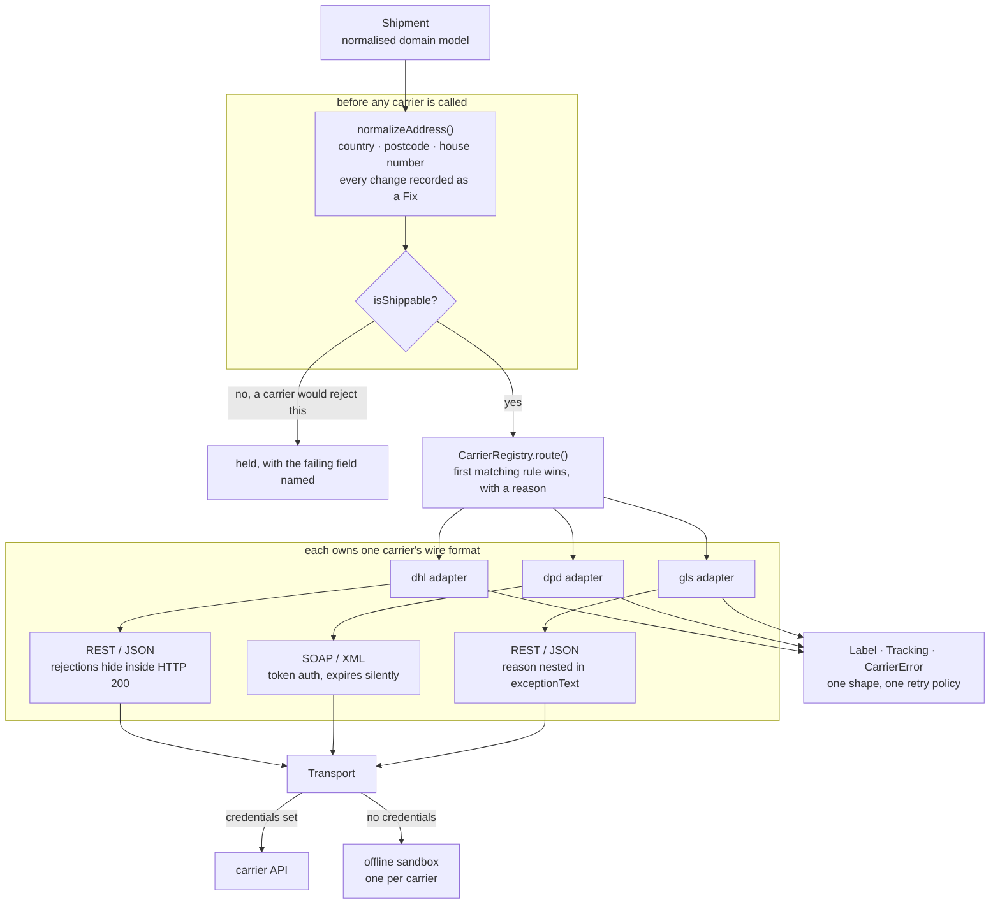

# carrier-adapter

One interface over DHL, DPD and GLS for labels and tracking, with address normalisation up front and an honest capability object instead of a lowest-common-denominator API.

Zero runtime dependencies. Every carrier ships with an offline sandbox, so it clones and runs with no credentials.

```
npm install && npm run demo
```

## Why this exists

I have integrated carrier APIs for live fulfilment, including a DPD Web Connect SOAP integration that still runs. Two things cost me the most time, and neither is the part people expect.

The first is that bad address data does not fail at checkout. It fails at label creation, which is after the order is picked, packed and sitting on a bench waiting to go. Someone then has to find it, work out which field is wrong, fix it and re-dispatch. The same four problems cause nearly all of it: a country name in a field typed as alpha-2, the postcode and city swapped by column drift in a feed, the house number buried in the street string when all three carriers want it separately, and a postcode with the wrong spacing for its country. So normalisation runs before any carrier is called, and every change is recorded rather than applied silently.

The second is that carriers are not interchangeable, and the usual adapter layer pretends they are. DPD's shipment service returns no price at all — not zero, not an error, there is no cost field, because pricing lives in the contract. An interface that models cost as a number and defaults it to zero produces a lie that ends up on an invoice. So cost is nullable and every carrier publishes a `Capabilities` object you can read before you call it.

## Architecture



## Quick start

```bash
git clone https://github.com/krunalp2801/carrier-adapter
cd carrier-adapter
npm install
npm test      # 104 tests, no credentials needed
npm run demo
```

The demo repairs five deliberately broken addresses, buys the same shipment from all three carriers, prints the capability table and the routing decisions with their reasons, and ends on a rejected label mapped to a typed error.

```
carrier  tracking         cost         status             events
dhl      DHL03878954      4.99 EUR     out_for_delivery   3
dpd      DPD04100794      not reported delivered          3
gls      GLS00939264      not reported in_transit         2
```

### Use it

```ts
import { normalizeAddress, isShippable, registryFromEnv, CarrierError } from "carrier-adapter";

// 1. Fix the address first. Nothing reaches a carrier unrepaired.
const { address, fixes, problems } = normalizeAddress(rawAddress);
if (!isShippable({ address, fixes, problems })) return hold(problems);
for (const fix of fixes) audit.log(fix);   // "postcode/city: Koeln / 50667 -> 50667 / Koeln"

// 2. Route, and keep the reason.
const { registry } = registryFromEnv(process.env);
const { carrier, reason } = registry.route(shipment);

// 3. One interface, one error type.
try {
  const label = await carrier.createLabel(shipment);
  if (label.costMinorUnits === null) {
    // Not a failure. This carrier has no price field at all.
  }
} catch (err) {
  if (err instanceof CarrierError && err.retryable) await again();
}
```

### Point it at a real sandbox

Copy `.env.example` to `.env` and fill in one section. A carrier with no credentials keeps its offline sandbox rather than disappearing, and `registryFromEnv` returns which ones are live, so a partially configured environment still works end to end.

### What the three carriers actually do differently

| | DHL | DPD | GLS |
|---|---|---|---|
| Wire format | REST / JSON | SOAP / XML | REST / JSON |
| Auth | API key header | login call, then a token in a SOAP header | basic |
| Reports a cost | yes | **no, there is no price field** | no |
| Idempotent create | no | no | yes, keyed on the shipment reference |
| Label formats | PDF, ZPL | PDF | PDF, ZPL |
| How failure arrives | HTTP 200 with per-item `validationMessages` | HTTP 200 with a SOAP Fault | real status code, reason nested in `exceptionText` |

Two of the three report a failed request as a success. That row is why the adapters do not check `res.ok` and move on.

The sandbox payloads are modelled on each carrier's documented response shape and are deliberately awkward in the places the real ones are. They are an honest model, not a substitute for the carriers' own documentation. The one asymmetry taken from first-hand production experience is DPD's missing cost, and the expired-token behaviour below.

## Design decisions

**The adapter boundary is the normalised domain model, not the carrier's shape.** Everything above an adapter speaks `Shipment`, `Label`, `Tracking` and `CarrierError`; everything inside speaks the carrier's own format and never lets it out. The test for this is cheap and worth having: `carriers.test.ts` runs the same contract suite against all three, so a field name leaking out of one adapter breaks a test rather than an application.

**Capabilities, not a lowest-common-denominator interface.** The standard way to build this layer is to expose only what the weakest carrier supports, which silently drops everything else. The failure mode is that a caller cannot tell "this carrier does not report cost" from "this shipment was free". So `Label.costMinorUnits` is `number | null`, every carrier publishes a `Capabilities` object, and a test asserts that a carrier claiming `reportsCost: false` returns `null` and never `0`.

**"Fault occured" means the token expired.** DPD Web Connect authenticates with a token that expires, and it does not tell you how long it lasts. When it goes stale you get HTTP 200, a SOAP Fault, and the fault string `Fault occured` — misspelled, and generic enough to send you auditing your envelope instead of your token. I lost most of a day to that on a live integration. The adapter matches that string, drops the cached token, re-authenticates and retries **once**. Once, not a loop: if a fresh token also faults, the problem is the credentials or the request, and a loop would just hammer the login service.

Matching on a message rather than a code is unpleasant. It is also necessary: DPD returns the same fault code for an expired token and a malformed request, so the message is the only thing that separates them.

**Address normalisation runs before routing, and records every change.** Quietly rewriting a customer's address is how you ship to the wrong place with nothing to show for it afterwards, so `normalizeAddress` returns a `Fix[]` describing what changed and why in words a support agent can read, plus `Problem[]` for what is still wrong. Nothing throws. A caller that wants to refuse a bad address checks for `severity: "error"`; a caller that wants to ship anyway can.

**The house number split is decided by the country, not by the string.** Continental Europe puts the number last, the UK and Ireland put it first. Guessing from the string gets "4 Seasons Road" wrong in one direction and "42 Mill Lane" wrong in the other, and there is a test for exactly that pair.

**One error type with a `kind`, so one retry policy covers three carriers.** `auth`, `validation`, `rate_limit`, `carrier_down`, `unknown`. `unknown` is deliberately not retryable: retrying a response we failed to understand is how a duplicate label gets bought and a customer gets two parcels.

**A seventy-line XML reader rather than a dependency.** This package sits in the path of buying real shipping labels with real customer addresses in the payload. Every dependency here is a package that can be compromised into an address exfiltration, and after the npm supply-chain incidents of the last year that is not a hypothetical. Seventy lines I can audit beat a transitive tree I cannot. The honest limit: it does not validate, and it would be the wrong choice for arbitrary XML from an untrusted source. DPD's response shape is pinned by the WSDL, which is what makes it defensible.

**Transport is injected.** Adapters never touch `fetch`. That is what lets a test assert the exact bytes of a SOAP envelope — a misplaced element in a DPD request is rejected with a message that does not say which element — and it is what the sandboxes plug into.

### Trade-offs

- **Six tracking statuses.** Carriers publish dozens of codes each and no two agree. Six is what a customer-facing message or a support queue actually branches on, and the carrier's own code is kept on every event so nothing is lost.
- **`createLabel` and `track`, and nothing else.** Pickup booking, manifests and returns each have enough carrier-specific shape that folding them in would grow a union type per carrier. Two methods is the honest size of the common surface.
- **The default routing rules are an example, not advice.** Real routing depends on which contracts a merchant holds and what each charges per zone. The rule list is a constructor argument, and each rule carries a human-readable reason so a dispatch desk can answer "why did this go DPD".
- **Country aliases are a lookup table, not an ISO dataset.** The countries a given merchant ships to are few and known. A full dataset is a dependency solving a problem nobody here has.
- **DPD returns one PDF for a whole consignment**, so every parcel in the label carries the same document. Splitting it would mean taking a PDF library into a shipping adapter, which is the wrong trade.

## What is next

- Retry with backoff built in rather than left to the caller, keyed off `CarrierError.retryable` and skipped entirely for carriers without `idempotentCreate`.
- `cancelLabel`, which all three support and all three shape differently.
- A `fromShopifyOrder` adapter so the domain model stays store-shaped at one boundary only, feeding straight out of [order-risk-agent](https://github.com/krunalp2801/order-risk-agent)'s address checks.
- Webhook ingestion for tracking, instead of polling a tracking endpoint per parcel.
- An address normalisation corpus from real failed labels, as a regression suite. Every rule in `address.ts` came from a specific broken order and should be pinned to it.

## Development

```bash
npm test          # typecheck + 104 tests
npm run typecheck
npm run build
npm run demo
```

Tests run straight from the TypeScript sources via Node's type stripping, so
**development needs Node 22.6+**, and the source avoids TypeScript syntax that
needs a real transform — notably parameter properties.

The built output is plain JavaScript and runs on **Node 20+**. CI proves both
separately: tests on 22 and 24, and a build-plus-demo job on 20.

MIT licensed.

---

Built by Krunal Patel, part of the Weekly Build series. More at https://www.krunal.de
